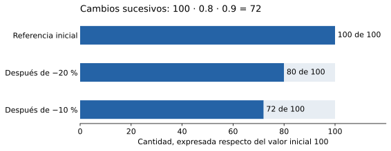

## Propósito y alcance

Los porcentajes expresan comparaciones con una referencia de cien unidades. Permiten interpretar participaciones, descuentos y variaciones, pero su significado depende del total o base de comparación. El capítulo conecta interpretaciones, cálculos y lectura crítica de porcentajes, manteniendo explícitas las condiciones de cada operación.

## Motivación y definición

Comparar 18 respuestas correctas de 20 con 21 de 30 exige tener en cuenta ambos totales. Expresar las razones respecto de cien facilita la comparación. En precios, encuestas y resultados educativos, la pregunta inicial es siempre: ¿porcentaje de qué cantidad?

:::: {.knowledge-object #tag-008P tag="008P" type="definicion" title="Porcentaje" pertenece_a="0000" requiere="00FV"}
::: {#def-008P .theorem-style-definition data-environment-tag="008P"}
## Porcentaje

Para $p\in\mathbb R$, el **porcentaje** $p\,\%$ es la razón de $p$ a cien:
$$p\,\%=\frac p{100}.$$
:::

Como participación de una parte en un total positivo suele tomar valores entre 0 y 100 %. Como comparación o variación puede superar 100 % o ser negativo. Hay que declarar el referente y el significado; no se impone el intervalo de una participación a todas las aplicaciones.

::: {#exm-008P .theorem-style-remark data-environment-tag="00GH"}
## Porcentaje

(a) $25\,\%=25/100=1/4$: expresa veinticinco partes de cada cien.

(b) $150\,\%=150/100=1.5$: un porcentaje puede representar más que el total de referencia.

(c) $0.5\,\%=0.5/100=0.005$: el símbolo porcentual divide el número escrito por cien.
:::
::::

:::: {.knowledge-object #tag-00GI tag="00GI" type="tecnica" title="Porcentaje como fracción y decimal" requiere="008P,00F1"}
::: {#concept-00GI .editorial-text}
### Porcentaje como fracción y decimal

Para pasar de un porcentaje a una fracción o decimal se divide el número porcentual por 100. Para expresar un número $r$ como porcentaje se escribe $(100r)\,\%$.
:::

La conversión modifica la escritura, no el número. Una cuadrícula de cien celdas ilustra porcentajes enteros entre 0 y 100; una recta o un operador permite ampliarlos a valores decimales y mayores que cien.

::: {#exm-00GI .theorem-style-remark data-environment-tag="00GJ"}
## Porcentaje como fracción y decimal

(a) $12.5\,\%=0.125=1/8$.

(b) Para expresar $0.7$ como porcentaje, se multiplica por cien: $0.7=70\,\%$.

(c) $3/5=0.6=60\,\%$; las tres expresiones representan la misma proporción.
:::
::::

:::: {.knowledge-object #tag-008Q tag="008Q" type="tecnica" title="Calcular un porcentaje de una cantidad" pertenece_a="0000" requiere="008P"}
::: {#concept-008Q .editorial-text}
### Calcular un porcentaje de una cantidad

Para calcular el $p\,\%$ de una cantidad $x$, se aplica el operador multiplicativo
$$y=x\cdot\frac{p}{100}.$$
La cantidad $y$ conserva la unidad de $x$.
:::

También puede calcularse el 1 % dividiendo por 100, y multiplicar después por $p$. La descomposición usa la distributividad: 15 % puede calcularse como 10 % más 5 %. En una participación, el total debe estar definido y las partes deben ser comparables.

::: {#exm-008Q .theorem-style-remark data-environment-tag="008R"}
## Calcular un porcentaje de una cantidad

(a) El $20\,\%$ de $350$ es $0.2\cdot350=70$.

(b) El $15\,\%$ de $200$ puede calcularse como $10\,\%+5\,\%$: $20+10=30$.

(c) Si se usa el $35\,\%$ de una reserva de $80\,\mathrm{L}$, se usan $28\,\mathrm{L}$ y quedan $52\,\mathrm{L}$.
:::
::::

## Determinación de la parte, el total y el porcentaje

:::: {.knowledge-object #tag-00GK tag="00GK" type="propiedad" title="Recuperar el total y calcular una participación" requiere="008Q,00EZ"}
::: {#prp-00GK .theorem-style-plain data-environment-tag="00GK"}
## Recuperar el total y calcular una participación

Si $y=\frac{xp}{100}$:

(a) Para $p\ne0$, el total es

    $$
    x=\frac{100y}{p}.
    $$

(b) Para $x\ne0$, el número porcentual es

    $$
    p=\frac{100y}{x}.
    $$

(c) Si $p=0$, conocer $y=0$ no permite recuperar un total único.
:::

Las fórmulas provienen de una misma relación. No se divide por el porcentaje escrito como si el número 20 fuera 0.20. Para una participación usual se requiere total positivo y una parte comprendida entre cero y el total.

::: {#exm-00GK .theorem-style-remark data-environment-tag="00GL"}
## Recuperar el total y calcular una participación

(a) Si $60$ representa el $15\,\%$ de un total $T$, $0.15T=60$ y $T=400$.

(b) Si $18$ de $24$ respuestas son correctas, la proporción es $18/24=0.75=75\,\%$.

(c) Una colección aumenta en $12$ objetos, equivalentes al $8\,\%$ de su tamaño inicial. Este era $12/0.08=150$ objetos.
:::
::::

## Aumentos, descuentos y recuperación del valor inicial

:::: {.knowledge-object #tag-00GM tag="00GM" type="propiedad" title="Factores de aumento y descuento" requiere="008Q"}
::: {#prp-00GM .theorem-style-plain data-environment-tag="00GM"}
## Factores de aumento y descuento

Para un valor inicial $x>0$:

(a) Un aumento de $p\,\%$, con $p\ge0$, produce

    $$
    y=x(1+\frac{p}{100}).
    $$

(b) Un descuento de $d\,\%$, con $0\le d\le100$, produce

    $$
    y=x(1-\frac{d}{100}).
    $$

La cantidad modificada es distinta de la cantidad que se añade o se descuenta.
:::

El 100 % representa la cantidad inicial. El factor reúne en una operación la base y su variación. Un descuento superior al 100 % no describe un precio final no negativo en este modelo.

::: {#exm-00GM .theorem-style-remark data-environment-tag="00GN"}
## Factores de aumento y descuento

(a) Un precio de $\$40\,000$ con descuento del $25\,\%$ queda en $40\,000(0.75)=\$30\,000$.

(b) Un precio de $\$40\,000$ con aumento del $25\,\%$ queda en $40\,000(1.25)=\$50\,000$.

(c) Una población inicial de $800$ que aumenta un $12\,\%$ pasa a $800(1.12)=896$ individuos.
:::
::::

:::: {.knowledge-object #tag-00GO tag="00GO" type="tecnica" title="Valor inicial a partir del valor final" requiere="00GM"}
::: {#concept-00GO .editorial-text}
### Valor inicial a partir del valor final

Si $y=xF$ y $F\ne0$, se recupera $x=y/F$. Para aumentos se usa $F=1+p/100$; para descuentos menores que 100 % se usa $F=1-d/100$.
:::

El porcentaje inverso se calcula sobre una base diferente. Para deshacer un aumento no se descuenta el mismo porcentaje. Con descuento total, el precio final cero no identifica el precio inicial.

::: {#exm-00GO .theorem-style-remark data-environment-tag="00GP"}
## Valor inicial a partir del valor final

(a) Si el precio final es $\$36\,000$ tras un descuento del $20\,\%$, el inicial es $36\,000/0.8=\$45\,000$.

(b) Si una cantidad final de $264$ resulta de un aumento del $10\,\%$, el valor inicial era $264/1.1=240$.

(c) Después de disminuir un $5\,\%$, quedan $57\,\mathrm{L}$. El volumen inicial era $57/0.95=60\,\mathrm{L}$.
:::
::::

## Variación absoluta, relativa y puntos porcentuales

:::: {.knowledge-object #tag-00GQ tag="00GQ" type="definicion" title="Variación absoluta y relativa" requiere="00GM"}
::: {#def-00GQ .theorem-style-definition data-environment-tag="00GQ"}
## Variación absoluta y relativa

Para valores inicial y final $x_0,x_1$:

(a) La **variación absoluta** es $\Delta x=x_1-x_0$.
(b) Si $x_0\ne0$, la **variación relativa respecto del valor inicial** es $r=(x_1-x_0)/x_0$.
(c) El cambio porcentual es $(100r)\,\%$.
:::

Para magnitudes usuales se interpreta con una base inicial positiva. Cuando la base es negativa, la fórmula puede producir un signo que no coincide con el lenguaje cotidiano de crecimiento y exige interpretación adicional. Si la base es cero, el cambio porcentual no está definido.

::: {#exm-00GQ .theorem-style-remark data-environment-tag="00GR"}
## Variación absoluta y relativa

(a) Pasar de $80$ a $100$ supone variación absoluta $20$ y relativa $20/80=25\,\%$.

(b) Volver de $100$ a $80$ supone variación absoluta $-20$ y relativa $-20/100=-20\,\%$.

(c) Pasar de $250$ a $275$ aumenta $25$ unidades, equivalentes al $10\,\%$ del valor inicial.
:::
::::

:::: {.knowledge-object #tag-00GS tag="00GS" type="definicion" title="Puntos porcentuales" requiere="00GQ"}
::: {#def-00GS .theorem-style-definition data-environment-tag="00GS"}
## Puntos porcentuales

Si una proporción pasa de $p\,\%$ a $q\,\%$, su cambio es de $q-p$ **puntos porcentuales**. Si $p\ne0$, su cambio porcentual relativo respecto de la proporción inicial es $100(q-p)/p\,\%$.
:::

Puntos porcentuales expresan una diferencia entre números porcentuales; cambio relativo expresa una razón respecto del inicial. Se requieren poblaciones y criterios comparables para interpretar el cambio de una tasa o proporción.

::: {#exm-00GS .theorem-style-remark data-environment-tag="00GT"}
## Puntos porcentuales

(a) Pasar del $40\,\%$ al $50\,\%$ añade $10$ puntos porcentuales y aumenta relativamente un $10/40=25\,\%$.

(b) Bajar del $12\,\%$ al $9\,\%$ reduce $3$ puntos porcentuales y un $3/12=25\,\%$ respecto del porcentaje inicial.

(c) Subir del $2\,\%$ al $4\,\%$ añade $2$ puntos porcentuales, pero duplica el porcentaje: el aumento relativo es $100\,\%$.
:::
::::

## Porcentajes sucesivos y referencias distintas

{fig-alt="Tres barras representan 100 inicial, 80 después de un descuento de veinte por ciento, y 72 después de otro descuento de diez por ciento sobre 80."}

:::: {.knowledge-object #tag-00GU tag="00GU" type="propiedad" title="Composición de porcentajes sucesivos" requiere="00GM,00EX"}
::: {#prp-00GU .theorem-style-plain data-environment-tag="00GU"}
## Composición de porcentajes sucesivos

Si cada cambio se aplica al resultado del anterior, con factores $F_1,\ldots,F_n$, entonces
$$x_n=x_0F_1\cdots F_n.$$
Para $x_0\ne0$, el cambio relativo total es $F_1\cdots F_n-1$.
:::

No se suman los porcentajes sucesivos como si todos tuvieran la misma base. En un modelo puramente multiplicativo el orden de los factores no altera el final; costos fijos, redondeos intermedios o restricciones pueden romper esa equivalencia.

::: {#exm-00GU .theorem-style-remark data-environment-tag="00GV"}
## Composición de porcentajes sucesivos

(a) Dos descuentos del $20\,\%$ y del $10\,\%$ dejan $0.8\cdot0.9=0.72$ del original: el descuento total es $28\,\%$.

(b) Un aumento del $20\,\%$ seguido de una disminución del $20\,\%$ deja $1.2\cdot0.8=0.96$, una disminución neta del $4\,\%$.

(c) Dos aumentos sucesivos del $10\,\%$ multiplican por $1.1^2=1.21$, un aumento total del $21\,\%$.
:::
::::

:::: {.knowledge-object #tag-00GW tag="00GW" type="observacion" title="Suma de porcentajes y base común" requiere="00GK"}
::: {#concept-00GW .editorial-text}
### Suma de porcentajes y base común

Sumar porcentajes describe una suma de partes solo cuando sus referentes son comunes y las partes pueden sumarse sin doble conteo. Si los totales son distintos, la participación conjunta se calcula sumando cantidades y luego dividiendo por el total conjunto.
:::

El promedio simple de porcentajes de grupos distintos solo coincide con la proporción global si sus tamaños son iguales, o bajo coincidencias particulares. Si los grupos se superponen, primero se elimina el doble conteo.

::: {#exm-00GW .theorem-style-remark data-environment-tag="00GX"}
## Suma de porcentajes y base común

(a) En un curso, el $20\,\%$ participa en música y el $30\,\%$ solo en deporte, sin superposición. En total participa el $50\,\%$ del mismo curso.

(b) En grupos de tamaños $10$ y $30$ aprueban $8$ y $15$ personas. El porcentaje global es $23/40=57.5\,\%$.

(c) Si el $30\,\%$ y el $40\,\%$ de una población pertenecen a dos grupos cuya intersección es el $10\,\%$, su unión representa $30+40-10=60\,\%$.
:::
::::

## Aplicaciones y lectura crítica

:::: {.knowledge-object #tag-00GY tag="00GY" type="aplicacion" title="Índices, composición y comparación de ofertas" requiere="00GQ,00FX"}
::: {#concept-00GY .editorial-text}
### Índices, composición y comparación de ofertas

En un índice de base 100, un nivel $I$ expresa $I/100$ veces la referencia. Los porcentajes de componentes describen una distribución si todos utilizan el mismo total y se controlan solapamientos. Las ofertas deben compararse mediante precio final por cantidad equivalente.
:::

Los ejemplos económicos son hipotéticos: una tasa elegida para ilustrar un cálculo no describe una obligación tributaria o un indicador vigente. Una rebaja, un porcentaje gratuito y una promoción por unidades requieren modelos distintos.

::: {#exm-00GY .theorem-style-remark data-environment-tag="00GZ"}
## Índices, composición y comparación de ofertas

(a) Un índice pasa de $100$ a $125$ y luego a $120$. Los cambios relativos son $25\,\%$ y $(120-125)/125=-4\,\%$.

(b) En una oferta de tres unidades por el precio de dos, el ahorro por unidad respecto del precio normal es $1/3$, aproximadamente $33.3\,\%$.

(c) Una oferta reduce un precio de $\$8000$ a $\$6000$; otra descuenta el $20\,\%$ del mismo precio y cobra $\$6400$. La primera tiene menor precio final.
:::
::::

## Preguntas relacionadas

- [Pregunta original sobre descuento](../../paes/m1/preguntas-originales/porcentajes.qmd#tag-00CD)

## Conexiones y procedencia

Desarrolla el capítulo 32 de la [tabla maestra](../../../docs/tabla-contenidos-maestra.md). Se conecta con [Razones y proporcionalidad](razones-proporcionalidad.qmd), [Números racionales](numeros-racionales.qmd) y [Potencias, raíces y logaritmos](../algebra/potencias-raices-logaritmos.qmd). Redacción y ejemplos originales; [Fuentes consultadas](../../../docs/referencias-numeros-medicion.md).
