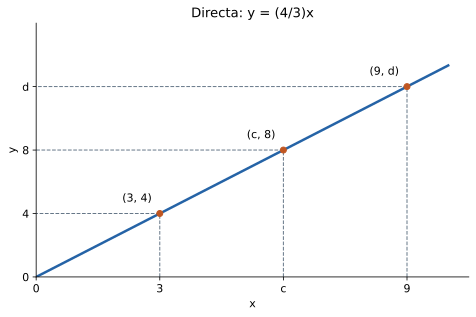
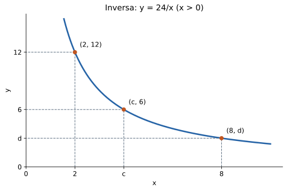

## Propósito y alcance

El razonamiento proporcional compara cantidades multiplicativamente. Se distinguen razón, tasa y proporción, y se establecen criterios para reconocer modelos directos e inversos. La selección del modelo precede al cálculo: se identifica si permanece constante un cociente o un producto y se justifican los supuestos del problema.

## Razón, tasa y proporción

:::: {.knowledge-object #tag-00FV tag="00FV" type="definicion" title="Razón y referentes de comparación" requiere="00EJ,00CH"}
::: {#def-00FV .theorem-style-definition data-environment-tag="00FV"}
## Razón y referentes de comparación

Sean $a,b\in\mathbb{R}$, con $b\ne0$. La **razón de $a$ a $b$** es el cociente
$$
\frac{a}{b}.
$$
También se representa mediante $a:b$. Los términos $a$ y $b$ se denominan **antecedente** y **consecuente**, respectivamente.
:::

Para comparar cantidades de la misma magnitud, se expresan primero en unidades compatibles. El orden de los términos importa. Una razón parte-parte y una razón parte-total no son intercambiables. La escritura fraccionaria puede representar un número sin unidad o una comparación contextual; hay que declarar qué significa cada término. Una razón no exige que el antecedente sea menor que el consecuente.

::: {#exm-00FV .theorem-style-remark data-environment-tag="00FW"}
## Razón y referentes de comparación

(a) **Comparación parte-parte y parte-total.** En una mezcla hay $2$ vasos de concentrado y $5$ de agua. La razón concentrado:agua es $2:5=2/5$; concentrado:mezcla es $2:7=2/7$. Cambiar el referente cambia la razón.

(b) **Orden de los términos.** En un curso hay $18$ estudiantes que llegan a pie y $12$ que llegan en bus. La razón entre quienes llegan a pie y quienes llegan en bus es $18:12=3:2$; en el orden contrario es $12:18=2:3$. El antecedente corresponde al grupo nombrado primero.

(c) **Unidades compatibles.** Para comparar $75\,\mathrm{cm}$ con $1.5\,\mathrm{m}$, se convierte $1.5\,\mathrm{m}=150\,\mathrm{cm}$. La razón es $75:150=1:2$, no $75:1.5$.
:::
::::

:::: {.knowledge-object #tag-00FX tag="00FX" type="definicion" title="Tasa y valor por unidad" requiere="00FV,00CT"}
::: {#def-00FX .theorem-style-definition data-environment-tag="00FX"}
## Tasa y valor por unidad

Una **tasa** es una razón entre cantidades de magnitudes distintas, por lo que conserva una unidad compuesta, como pesos por kilogramo o kilómetros por hora. Una **tasa unitaria** expresa el valor correspondiente a una unidad del denominador.
:::

La tasa media resume totales de un intervalo o conjunto; no afirma que la relación sea constante en cada instante. Igualar unidades permite comparar ofertas, pero pueden importar otras condiciones, como costos fijos o restricciones de cantidad.

::: {#exm-00FX .theorem-style-remark data-environment-tag="00FY"}
## Tasa y valor por unidad

(a) **Precio por unidad.** Si $3\,\mathrm{kg}$ cuestan $\$7500$, el costo medio es $7500/3=2500$ pesos por kilogramo. Esta compra no basta para afirmar que el precio unitario sea el mismo para cualquier cantidad.

(b) **Rapidez media.** Un ciclista recorre $45\,\mathrm{km}$ en $3\,\mathrm{h}$. Su rapidez media es $45/3=15\,\mathrm{km\,h^{-1}}$; esto no significa que mantenga esa rapidez en cada instante.

(c) **Comparación de ofertas.** Un envase de $750\,\mathrm{g}$ cuesta $\$3000$ y otro de $1\,\mathrm{kg}$ cuesta $\$3800$. El primero cuesta $3000/0.75=4000$ pesos por kilogramo. Si solo se considera el precio por masa, conviene el segundo.
:::
::::

:::: {.knowledge-object #tag-00FZ tag="00FZ" type="definicion" title="Proporción e igualdad de razones" requiere="00FV,00EN"}
::: {#def-00FZ .theorem-style-definition data-environment-tag="00FZ"}
## Proporción e igualdad de razones

Una **proporción** es una igualdad de razones:
$$\frac ab=\frac cd,$$
con $b,d\ne0$. Equivale a $ad=bc$.
:::

Una proporción compara razones; no es sinónimo de cualquier relación entre cantidades. Multiplicar ambos términos de una razón por un mismo factor no nulo conserva su valor. Los productos cruzados resuelven una igualdad ya justificada, pero no establecen por sí solos el modelo.

::: {#exm-00FZ .theorem-style-remark data-environment-tag="00G0"}
## Proporción e igualdad de razones

(a) **Comprobar una igualdad.** Las razones $2/5$ y $6/15$ forman una proporción porque $2\cdot15=5\cdot6=30$. Triplicar ambos términos conserva la razón.

(b) **Encontrar un término desconocido.** Si $3/4=x/20$, entonces $4x=60$ y $x=15$. También se obtiene multiplicando por $5$ ambos términos de $3/4$.

(c) **Detectar un cambio de razón.** Añadir tres vasos de concentrado y tres de agua a una mezcla $2:5$ produce $5:8$. Como $2\cdot8=16$ y $5\cdot5=25$, las razones $2/5$ y $5/8$ no son iguales.
:::
::::

## Proporcionalidad directa

:::: {.knowledge-object #tag-00G1 tag="00G1" type="definicion" title="Relación directamente proporcional" requiere="00FX,00FZ"}
::: {#def-00G1 .theorem-style-definition data-environment-tag="00G1"}
## Relación directamente proporcional

Dos cantidades variables $x,y$ son **directamente proporcionales**, y se escribe $y\propto x$, si existe una **constante de proporcionalidad** $k\in\mathbb{R}\setminus\{0\}$ tal que
$$
y=kx
$$
para todos los pares de valores correspondientes.
:::

Para $x\ne0$, el cociente $y/x=k$ es constante. En modelos de cantidades positivas se toma $k>0$. La unidad de $k$ es la unidad de $y$ dividida por la de $x$. Duplicar $x$ duplica $y$; sumar entradas suma las salidas correspondientes cuando los valores son admisibles. Si cero pertenece al dominio, corresponde a cero. El dominio de un problema puede ser discreto y no contener todos los reales.

Si se conoce un par $(x_1,y_1)$ con $x_1\ne0$, se obtiene $k=y_1/x_1$ y luego
$$
y_2=kx_2=y_1\frac{x_2}{x_1}.
$$
El paso por la unidad consiste en calcular primero $k$, el valor de $y$ que corresponde a $x=1$, cuando este valor es admisible.

::: {#exm-00G1 .theorem-style-remark data-environment-tag="00G2"}
## Relación directamente proporcional

(a) **Completar una tabla.** Las magnitudes $P$ y $Q$ son directamente proporcionales:

    | $P$ | $a$ | $8$ | $3$ |
    |:---:|:---:|:---:|:---:|
    | $Q$ | $40$ | $b$ | $24$ |

    Del par $(3,24)$ se obtiene $k=Q/P=24/3=8$. Por tanto, $Q=8P$: $a=40/8=5$ y $b=8\cdot8=64$. Así, $a+b=69$.

(b) **Leer un gráfico.** En la figura, la recta pasa por $(3,4)$, $(c,8)$ y $(9,d)$. Del primer punto se obtiene $k=4/3$. Luego $8=(4/3)c$, de donde $c=6$; además, $d=(4/3)\cdot9=12$. Por tanto, $c-d=-6$.

    {fig-alt="Recta y igual a cuatro tercios de x, que pasa por el origen. Se marcan los puntos (3,4), (c,8) y (9,d), con guías hacia los ejes; c vale 6 y d vale 12." width=620}

(c) **Calcular una cantidad en contexto.** Un alimento aporta $80\,\mathrm{kcal}$ por cada $250\,\mathrm{g}$. Si la composición es uniforme, el aporte es directamente proporcional a la masa. Como $4.5\,\mathrm{kg}=4500\,\mathrm{g}$, hay $4500/250=18$ porciones y el aporte es $18\cdot80=1440\,\mathrm{kcal}$. Equivale a usar $k=80/250=0.32\,\mathrm{kcal\,g^{-1}}$.
:::
::::

:::: {.knowledge-object #tag-00G3 tag="00G3" type="tecnica" title="Tablas y gráficos de proporcionalidad directa" requiere="00G1"}
::: {#concept-00G3 .editorial-text}
## Tablas y gráficos de proporcionalidad directa

Para contrastar un modelo directo se comprueba que los cocientes $y/x$ sean iguales para las entradas no nulas. Su representación gráfica está contenida en una recta que pasa por el origen; si el dominio es discreto, se representan solo los puntos admisibles.
:::

Que dos cantidades aumenten simultáneamente no basta. En una tabla finita, los datos pueden ser compatibles con proporcionalidad sin demostrar que la relación se extienda a todos los valores. Es necesario considerar el mecanismo o los supuestos del modelo.

::: {#exm-00G3 .theorem-style-remark data-environment-tag="00G4"}
## Tablas y gráficos de proporcionalidad directa

(a) **Verificar cocientes.** Para los pares $(1,800)$, $(2,1600)$ y $(5,4000)$, los cocientes son $800$, $800$ y $800$. Los datos son compatibles con $y=800x$; el precio fijo de $\$800$ por cuaderno, sin cargos adicionales, justifica el modelo.

(b) **Comprobar el origen.** La recta que pasa por $(0,0)$ y $(3,4)$ tiene ecuación $y=(4/3)x$. Para $x=6$, entrega $y=8$ y conserva el cociente $y/x=4/3$.

(c) **Respetar el dominio.** A $\$800$ por cuaderno, $y=800x$ con $x\in\{0,1,2,\ldots\}$. Se dibujan puntos aislados sobre la recta: el punto $(1.5,1200)$ pertenece a la recta, pero no representa una compra de cuadernos enteros.
:::
::::

## Proporcionalidad inversa

:::: {.knowledge-object #tag-00G5 tag="00G5" type="definicion" title="Relación inversamente proporcional" requiere="00FX,00FZ"}
::: {#def-00G5 .theorem-style-definition data-environment-tag="00G5"}
## Relación inversamente proporcional

Dos cantidades variables $x,y$ son **inversamente proporcionales**, y se escribe $y\propto 1/x$, si existe una **constante de proporcionalidad** $k\in\mathbb{R}\setminus\{0\}$ tal que
$$
xy=k
$$
para todos los pares de valores correspondientes.
:::

Como $k\ne0$, ambas variables son no nulas y la igualdad equivale a $y=k/x$. En modelos de cantidades positivas, $x,y,k>0$. Duplicar una variable reduce la otra a la mitad. La constante tiene unidad producto, no cociente. Que una variable aumente y otra disminuya no basta para identificar proporcionalidad inversa.

Si se conoce un par $(x_1,y_1)$, se obtiene $k=x_1y_1$ y luego, para $x_2\ne0$,
$$
y_2=\frac{k}{x_2}=y_1\frac{x_1}{x_2}.
$$
Antes de calcular se determina qué producto permanece constante y se comprueba si el resultado debe aumentar o disminuir.

::: {#exm-00G5 .theorem-style-remark data-environment-tag="00G6"}
## Relación inversamente proporcional

(a) **Completar una tabla.** Las magnitudes positivas $P$ y $Q$ son inversamente proporcionales:

    | $P$ | $a$ | $8$ | $3$ |
    |:---:|:---:|:---:|:---:|
    | $Q$ | $6$ | $b$ | $8$ |

    Del par $(3,8)$ se obtiene $k=PQ=24$. Por tanto, $a=24/6=4$ y $b=24/8=3$. Así, $a+b=7$.

(b) **Leer un gráfico.** La curva de la figura pasa por $(2,12)$, $(c,6)$ y $(8,d)$. Como $k=2\cdot12=24$, se obtiene $c=24/6=4$ y $d=24/8=3$. Por tanto, $c-d=1$.

    {fig-alt="Rama de hipérbola y igual a 24 dividido por x, con x positivo. Se marcan los puntos (2,12), (c,6) y (8,d), con guías hacia los ejes; c vale 4 y d vale 3. La curva no corta los ejes." width=620}

(c) **Calcular un tiempo en contexto.** Para recorrer $120\,\mathrm{km}$ a rapidez constante $v$, sin detenciones, el tiempo es $t=120/v$. A $40\,\mathrm{km\,h^{-1}}$ toma $3\,\mathrm{h}$; a $60\,\mathrm{km\,h^{-1}}$, $2\,\mathrm{h}$. La rapidez se multiplica por $1.5$ y el tiempo se divide por $1.5$; el producto $vt$ permanece en $120\,\mathrm{km}$.
:::
::::

:::: {.knowledge-object #tag-00G7 tag="00G7" type="tecnica" title="Tablas, gráficos y supuestos de un modelo inverso" requiere="00G5"}
::: {#concept-00G7 .editorial-text}
## Tablas, gráficos y supuestos de un modelo inverso

Un modelo inverso se contrasta mediante productos constantes. Para variables positivas, su gráfica es una rama de hipérbola en el primer cuadrante; no corta los ejes. Al cambiar una variable por un factor $r>0$, la otra cambia por el factor $1/r$.
:::

En tareas de trabajo y tiempo se requieren supuestos: igual productividad, trabajo divisible y ausencia de interferencia. No toda tarea se acelera en proporción al número de personas. Si hay tiempo fijo de preparación, la relación total deja de ser inversamente proporcional.

::: {#exm-00G7 .theorem-style-remark data-environment-tag="00G8"}
## Tablas, gráficos y supuestos de un modelo inverso

(a) **Verificar productos.** Los pares $(2,12)$, $(4,6)$ y $(8,3)$ satisfacen $2\cdot12=4\cdot6=8\cdot3=24$. Son compatibles con el modelo $y=24/x$; sus cocientes, en cambio, no son constantes.

(b) **Trabajo divisible.** Una tarea requiere $24$ horas-persona. Con igual productividad y sin interferencias, $2$ personas necesitan $12$ horas y $6$ personas, $4$ horas. El número de personas se triplica y el tiempo se divide por $3$.

(c) **Reconocer un supuesto que falla.** Si esa tarea incluye además $2$ horas fijas de espera, el tiempo total es $t=24/n+2$. Para $n=2$ y $n=6$ se obtienen $14$ y $6$ horas: los productos $2\cdot14=28$ y $6\cdot6=36$ difieren. El tiempo total no es inversamente proporcional al número de personas.
:::
::::

## Tasa media y composición de razones

:::: {.knowledge-object #tag-00GD tag="00GD" type="tecnica" title="Tasa media y composición de razones" requiere="00FX"}
::: {#concept-00GD .editorial-text}
## Tasa media y composición de razones

La tasa media de un conjunto de tramos se obtiene dividiendo el total de la magnitud del numerador por el total de la magnitud del denominador. Componer tasas exige mantener unidades compatibles y controlar qué cantidades se cancelan.
:::

El promedio aritmético de tasas solo coincide con la tasa global bajo condiciones específicas. Por ejemplo, el promedio de rapideces es adecuado para tiempos iguales, no para distancias iguales. Las tablas con unidades permiten reconstruir el cálculo.

::: {#exm-00GD .theorem-style-remark data-environment-tag="00GE"}
## Tasa media y composición de razones

(a) **Tramos de igual distancia.** Recorrer $60\,\mathrm{km}$ a $30\,\mathrm{km\,h^{-1}}$ toma $2\,\mathrm{h}$ y otros $60\,\mathrm{km}$ a $60\,\mathrm{km\,h^{-1}}$ toma $1\,\mathrm{h}$. La rapidez media es $120/3=40\,\mathrm{km\,h^{-1}}$.

(b) **Tramos de igual tiempo.** Viajar $1\,\mathrm{h}$ a $30\,\mathrm{km\,h^{-1}}$ y otra hora a $60\,\mathrm{km\,h^{-1}}$ suma $90\,\mathrm{km}$ en $2\,\mathrm{h}$. Aquí la rapidez media es $45\,\mathrm{km\,h^{-1}}$, que coincide con el promedio aritmético porque los tiempos son iguales.

(c) **Componer tasas.** Una máquina produce $12$ piezas por minuto y cada pieza requiere $0.25\,\mathrm{kg}$ de material. El consumo es $(12\,\mathrm{piezas\,min^{-1}})(0.25\,\mathrm{kg\,pieza^{-1}})=3\,\mathrm{kg\,min^{-1}}$. La unidad pieza se cancela.
:::
::::

## Relaciones afines y otros contraejemplos

:::: {.knowledge-object #tag-00GF tag="00GF" type="observacion" title="Relaciones afines y otros contraejemplos" requiere="00G3,00G7"}
::: {#concept-00GF .editorial-text}
## Relaciones afines y otros contraejemplos

Una relación $y=kx+b$ con $b\ne0$ no es directamente proporcional, aunque su gráfica sea una recta. Un modelo $y=kx^2$ con $k\ne0$ tampoco lo es. Una dependencia decreciente, como $y=10-x$, no es en general inversamente proporcional.
:::

El razonamiento aditivo y el multiplicativo responden a estructuras distintas. Detectar un cargo fijo, un área o una restricción permite evitar una regla de tres injustificada. Los datos deben leerse junto con el contexto y el dominio.

::: {#exm-00GF .theorem-style-remark data-environment-tag="00GG"}
## Relaciones afines y otros contraejemplos

(a) **Tarifa con cargo fijo.** Con $y=1000+500x$, para $x=2$ se paga $\$2000$ y para $x=4$, $\$3000$. Duplicar $x$ no duplica el precio; además, $2000/2\ne3000/4$. La relación es afín y no directamente proporcional.

(b) **Dependencia cuadrática.** En $y=x^2$, los pares $(2,4)$ y $(4,16)$ tienen cocientes $4/2=2$ y $16/4=4$. Aunque ambas variables aumentan, no hay proporcionalidad directa.

(c) **Disminución sin producto constante.** En $y=10-x$, los pares $(2,8)$ y $(4,6)$ dan productos $16$ y $24$. La variable $y$ disminuye al aumentar $x$, pero la relación no es inversamente proporcional.
:::
::::

## Conexiones y procedencia

Desarrolla el capítulo 31 de la [tabla maestra](../../../docs/tabla-contenidos-maestra.md), «Razones y proporcionalidad». Se conecta con [Racionales](numeros-racionales.qmd), [Magnitudes y unidades](magnitudes-medicion-unidades.qmd), [Porcentajes](porcentajes.qmd) y [Funciones](../algebra/funciones.qmd). Redacción y ejemplos originales; [Fuentes consultadas](../../../docs/referencias-numeros-medicion.md).
